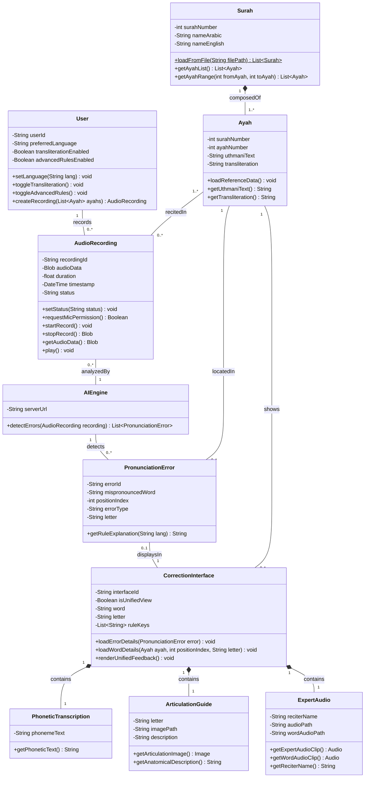

# Faseeh class diagram

The browser implements the ten classes below. The two actors in the use cases meet at `AIEngine.detectErrors(recording)`. That method sends a completed recording to FastAPI and converts the model’s findings into objects that point to the selected ayahs.

## Follow an ayah through the program

1. **Select a passage.** Loading the catalog creates a Surah and its owned Ayah instances. An inclusive range returns references to those same ayahs. The reader uses the supplied Uthmani text, selectable words and optional transliteration. [Library](../web/library.js) · [Reader](../web/studio.js)
2. **Make a recording.** The anonymous User creates an AudioRecording bound to that user, one analysis engine and a nonempty sequence of consecutive ayahs. Microphone recording and file upload populate the same audio field. The user ID stays in the page session. Only language and display preferences persist. [User](../web/user.js) · [Audio recording](../web/audio-recording.js)
3. **Analyze the completed audio.** The engine submits the selected range and audio, handles replica failover, and locates each error by ayah and zero-based word position. The recording also carries the server’s coverage, score and playback timings. [Analysis client](../web/ai-engine.js) · [Python inference](../muaalem_engine.py)
4. **Open a word.** A lookup starts with an Ayah and word position. Each PronunciationError creates its own CorrectionInterface during analysis. Opening the finding loads its transcription, articulation guide and expert audio. When several findings concern the same word, the learner can switch between them inside the dialog. [Correction interface](../web/correction-interface.js) · [Word study classes](../web/word-media.js)

The sequence diagrams add `Ayah.loadReferenceData()` and `AudioRecording.setStatus(status)` to the original class operations. File and reference loading, microphone permission, stopping the recorder and inference return promises. The articulation image is an accessible SVG. Word audio uses a timed excerpt of the bundled ayah recording. [Sequence diagrams](sequence-diagrams.md)

## Verification

The class tests check object identity across a selection, recording, detected error and correction card. They also check range multiplicity, preferences, the completed microphone Blob, and the card’s three components. The Chromium flow exercises microphone consent, failover, playback, word lookup and switching between two findings on the same word. [Class tests](../tests/class-model.test.mjs) · [Browser flow](../tests/browser_flow.py)
