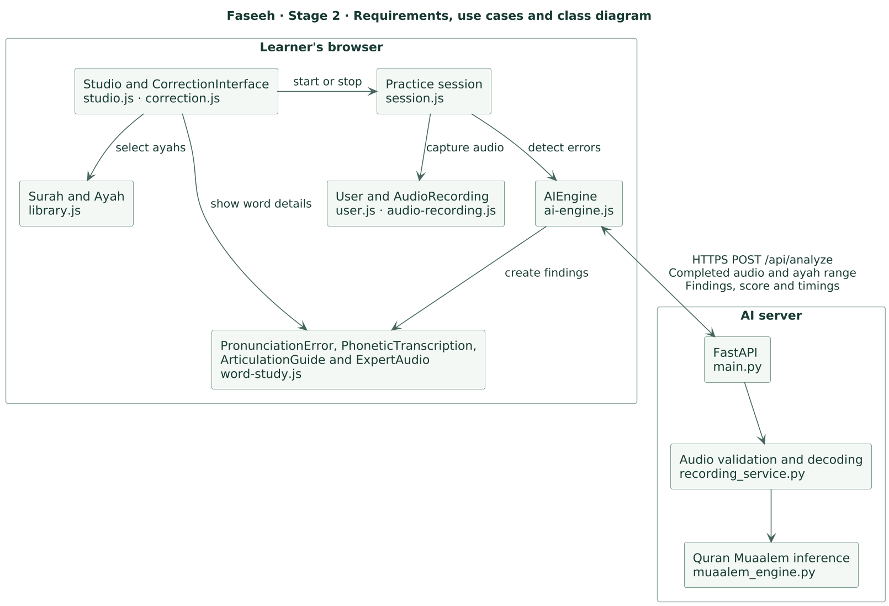

# Stage 2 · Requirements, use cases and class diagram

The application on `Faseeh-v3gpt` comes from the ten-class build at `b445e1d`. Each report below comes from a separate OODM CLI 2.0.2 run on these same 25 source files. [Original application](https://github.com/Lx-Drd/Faseeh-WebApp/tree/b445e1de48b2fd5901d13298216a76d6fc466de3) · [Download the Stage 2 measurement pack](https://github.com/Lx-Drd/Faseeh-WebApp/raw/refs/heads/Faseeh-v3gpt/docs/measurements/stage-2-measurements.zip)

| Report in the ZIP | #10 Structure | #11 Behavior | #12 Use cases | #13 Architecture |
| --- | ---: | ---: | ---: | ---: |
| `reports/stage-inputs.html` | 91.3% | N/A | 41.7% | 10.0/10 |
| `reports/common-reference.html` | 91.3% | 46.9% | 41.7% | 10.0/10 |

The first report uses the original class diagram, the 12 SRD use cases and the Stage 2 architecture rules. OODM matched all 10 classes, all 25 methods and seven of 11 relationships. The sequence diagrams were introduced in Stage 3, so the behavioral score is N/A in this run. The second run also supplied those sequences as evaluation inputs and matched 15 of 32 messages in the Stage 2 code. Both reports belong to Stage 2. [Class diagram](../class-faseeh.puml) · [Use cases](../usecases.txt) · [Layer rules](../architecture.json) · [Scores as CSV](results.csv)

## Architecture

The browser session coordinates `User`, `AudioRecording` and `AIEngine`. The reader selects `Ayah` objects from a `Surah`. The correction screen uses the word-study classes for phonetics, articulation and playback. The AI client sends completed audio to FastAPI, which delegates decoding and inference to the recording service and Quran Muaalem. The architecture file lists modules present in this snapshot. OODM observed five cross-layer dependencies and allowed all five.



[Editable architecture diagram](architecture.puml)

## Run OODM on Stage 2

Select `Faseeh-v3gpt` in GitHub Desktop, open the repository folder in PowerShell, and run the following command with Node.js 18 or newer. OODM discovers the Stage 2 inputs in `docs`.

```powershell
npx.cmd --yes oodm-cli@2.0.2 . --format html --out oodm-stage-2.html
```

The ZIP also includes the exact inputs for both runs, JSON results and Windows commands for measuring an existing local copy. Open `START-HERE.txt` after extracting it.
