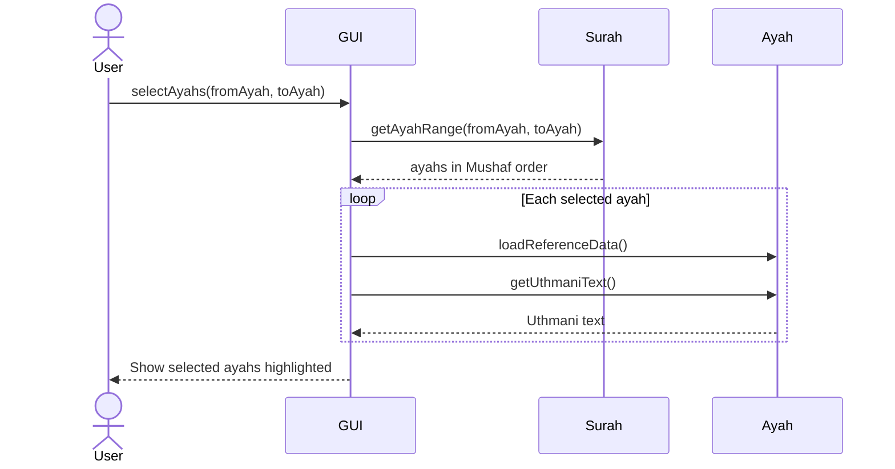
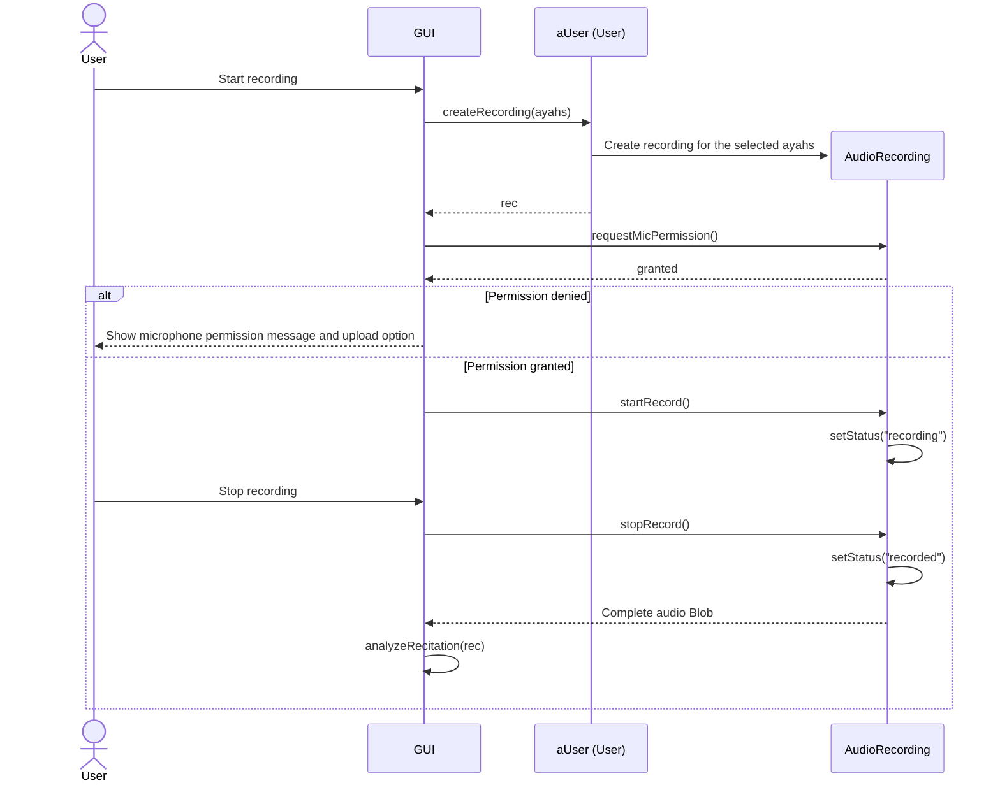
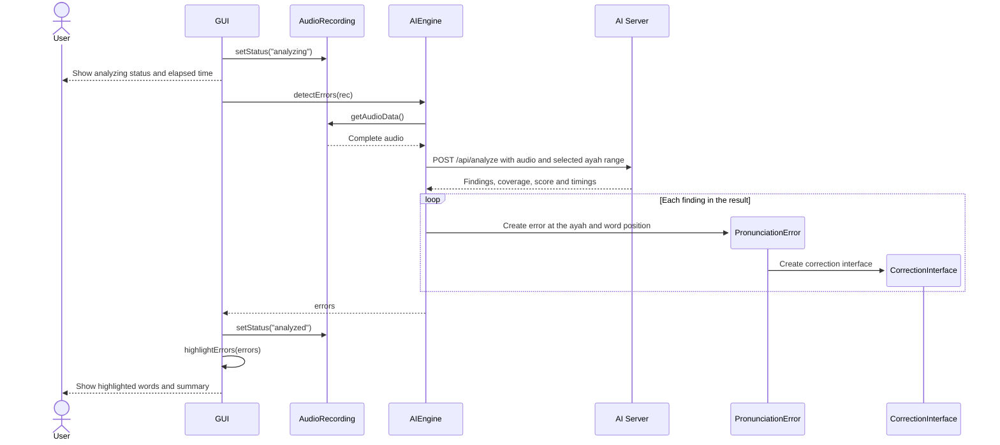
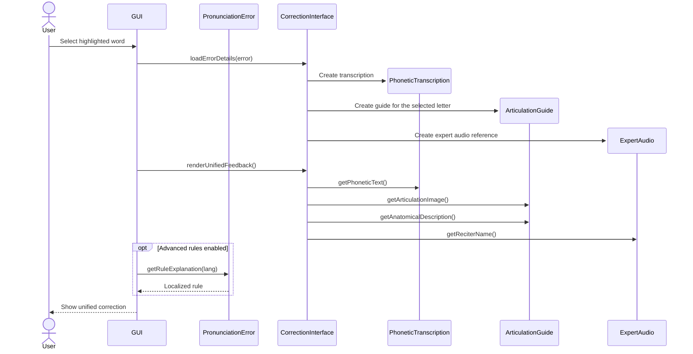

# Faseeh sequence diagrams

The four interactions follow a learner from selecting a passage to reviewing a highlighted word. The GUI is the browser studio and its recording session. The AI server runs the pretrained Quran Muaalem model. [Studio](../web/studio.js) · [Recording session](../web/session.js) · [Class diagram](class-diagram.md)

## Select Ayahs

Both ends of the range are included. Each ayah combines the catalog’s text, transliteration, word timings and audio path with the bundled phonetic reference. Recording, listening and upload become available when the current selection is ready. If the learner changes the range during loading, only the latest selection appears. [Library](../web/library.js) · [Selection and highlighting](../web/studio.js)

## Record Recitation

The recording stops its microphone tracks and resolves with the complete audio before analysis starts. File upload enters the same analysis flow with the selected file. [User](../web/user.js) · [Audio recording](../web/audio-recording.js) · [Session](../web/session.js)

## Analyze Recitation

Each finding gets its own correction interface, including findings on the same word. A successful response with zero findings shows the score and a clear result. Cancellation or a server failure ends the interaction before any highlights are applied. [Analysis client](../web/ai-engine.js) · [Pronunciation error](../web/word-study.js) · [Server](../main.py)

## View Unified Correction

The studio opens the interface belonging to the selected finding. The learner can switch findings, change language, toggle advanced rules and play the expert or their own recording within the dialog. Selecting an unflagged word opens a lookup card for its ayah and word position. [Card selection](../web/correction.js) · [Correction interface](../web/correction-interface.js) · [Study media](../web/word-media.js)

## Verification

The Chromium test traces the method calls for all four interactions through the actual controls. It covers permission refusal, a reference retry with overlapping selections, a successful recording, two findings on one word, and advanced rules in both states. The class tests check that each error owns a distinct interface before any of its study media are created. [Browser flow](../tests/browser_flow.py) · [Class tests](../tests/class-model.test.mjs)
